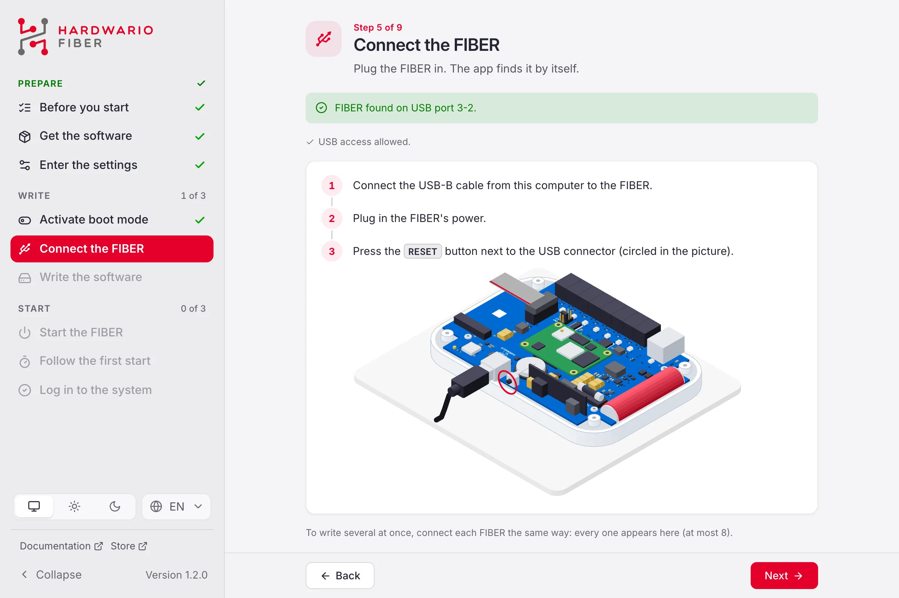
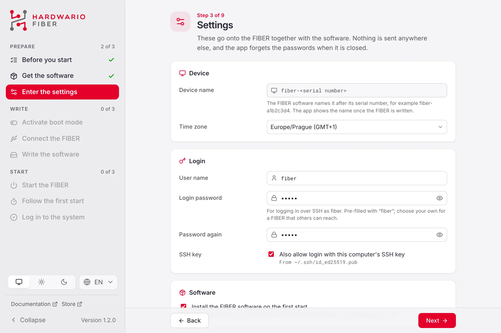
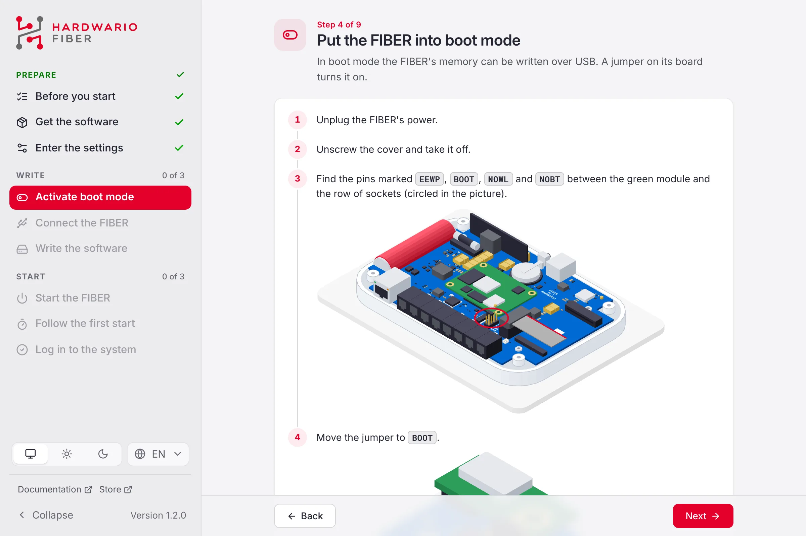
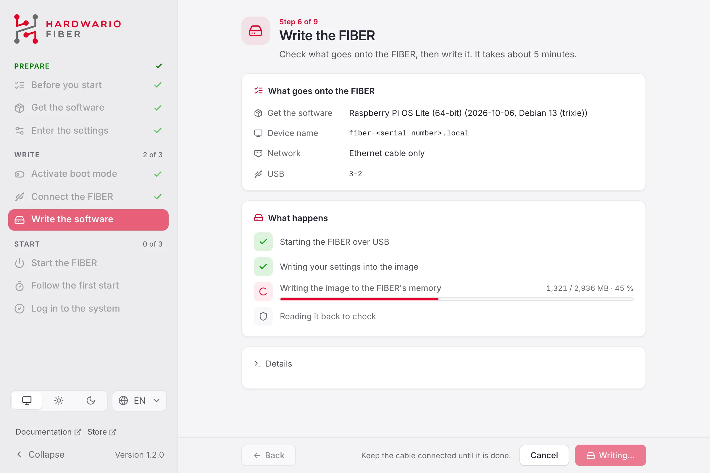
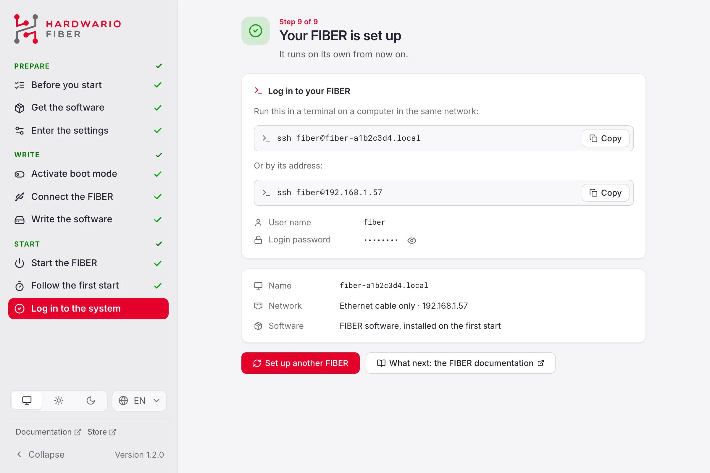
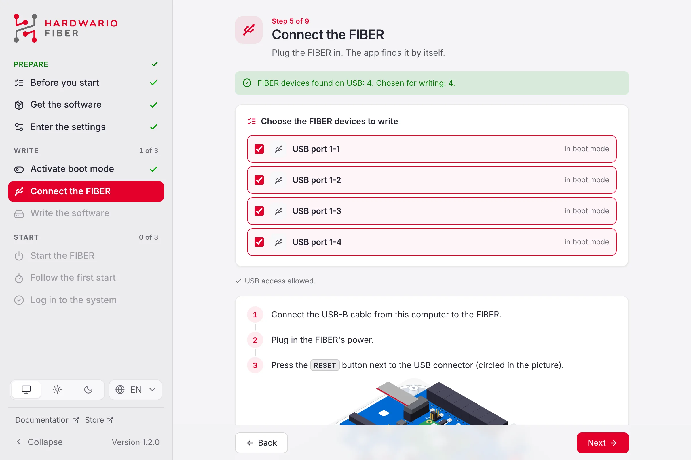
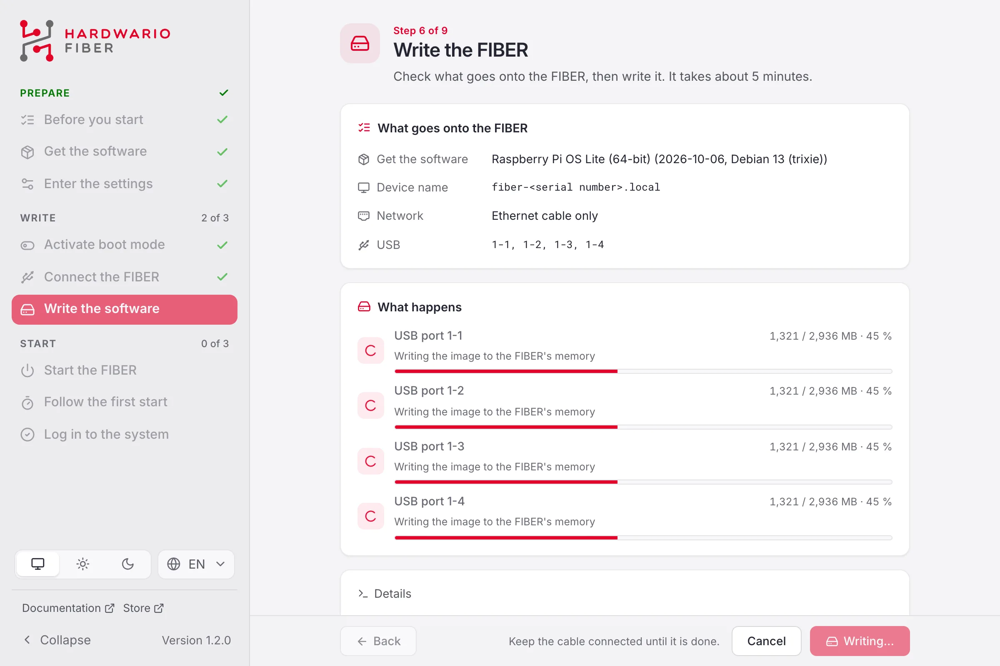

<p align="center">
  
</p>

<h1 align="center">FIBER Setup</h1>

<p align="center">
  Sets up a HARDWARIO FIBER from your computer,<br>
  step by step, with nothing but a USB cable.
</p>

<p align="center">
  <a href="https://github.com/hardwario/fiber-setup/actions/workflows/ci.yml"></a>
  <a href="https://github.com/hardwario/fiber-setup/releases/latest"></a>
  <a href="LICENSE"></a>
</p>

<p align="center">
  <a href="https://github.com/hardwario/fiber-setup/releases/latest"><b>Download</b></a> ·
  <a href="#the-steps">The steps</a> ·
  <a href="#several-fibers-at-once">Several FIBERs at once</a> ·
  <a href="#command-line">Command line</a> ·
  <a href="#building-from-source">Building from source</a>
</p>



## What it does

FIBER Setup is a desktop app for the HARDWARIO **[FIBER](https://docs.hardwario.com/fiber/)**, which is built
on a Raspberry Pi Compute Module 4. Connect the FIBER to your computer with a USB cable, and the app:

- downloads Raspberry Pi OS with the [FIBER platform](https://github.com/hardwario/fiber-platform) already
  in it, and checks it against its published checksum;
- puts your settings into it: the device's name, the login, the time zone and the Wi-Fi;
- writes it to the FIBER's built-in memory (eMMC) and reads it all back to check;
- has the FIBER turn on the components you tick by itself on its first start, without the internet;
- follows the first start step by step, and hands you the command to log in and a link to each component.

Each step says what to do, with drawings of the FIBER that show where the jumper, the cable and the buttons
are. One FIBER or up to eight at once.

It runs on Windows, macOS and Linux, in English, Czech, German, Slovak and Polish. `fiber-setup-cli`, its
sibling for the terminal, writes a FIBER without a window.

## What you need

- A FIBER and its power supply (PoE injector, 802.3af).
- A USB cable with a USB-B plug for the FIBER: a data cable, not a charging-only one.
- A small screwdriver to open the cover.
- Your Wi-Fi name and password, or an Ethernet cable to your network.
- The internet on the computer, for the download (once). The FIBER needs none for its first start.

It takes about 15 minutes: about 5 to write, and about 4 for the FIBER's first start with every component
ticked (measured on a FIBER: 4 min 11 s from `RESET`). Everything on the FIBER's built-in memory is replaced.

## Download

Get the [latest release](https://github.com/hardwario/fiber-setup/releases/latest):

| Platform | File |
|---|---|
| Windows 10/11 (x64) | `fiber-setup-<version>-windows-x64-setup.exe` (installer), or `fiber-setup-<version>-windows-x64-portable.zip` |
| macOS 11+ (Apple silicon and Intel) | `fiber-setup-<version>-macos-universal.dmg` |
| Linux (x86_64) | `fiber-setup-<version>-linux-x86_64.AppImage`, or `fiber-setup-<version>-linux-x86_64.deb` |

Each file has its checksum next to it (`shasum -a 256 -c <file>.sha256`).

### First run

<details>
<summary><b>Windows</b></summary>

Run the installer. It puts the app into Program Files, installs Microsoft's WebView2 where Windows does not
have it yet, and installs the USB driver. The portable zip is the same app in a folder: unpack it anywhere
and start `fiber-setup.exe`.

- The app asks for administrator rights when it starts (the usual Windows prompt): writing a disk and
  installing a driver both need them.
- Windows has no driver for a FIBER in boot mode. FIBER Setup brings one: a few lines that tell Windows to
  use its own WinUSB, signed by HARDWARIO a.s. Windows asks once whether to trust software from
  HARDWARIO a.s. With the portable zip, the *Connect the FIBER* step offers *Install the USB driver*.
- The installer and the app are signed by HARDWARIO a.s. While a new release is still unknown to SmartScreen
  it may warn: choose *More info → Run anyway*.

</details>

<details>
<summary><b>macOS</b></summary>

Open the dmg and drag *FIBER Setup* to *Applications*.

- The app is signed by HARDWARIO and notarized by Apple, so it opens without warnings.
- There is nothing to install or allow beforehand. When the write starts, macOS asks for the password or
  Touch ID of an administrator: that is the right to open the FIBER's memory, and no other disk. It asks
  once, also for several FIBERs. Nothing of the app runs as root.

</details>

<details>
<summary><b>Linux</b></summary>

Make the AppImage executable and start it, or install the deb:

```sh
chmod +x fiber-setup-*-linux-x86_64.AppImage && ./fiber-setup-*-linux-x86_64.AppImage
sudo apt install ./fiber-setup-*-linux-x86_64.deb
```

- The first time, the *Connect the FIBER* step asks to **allow USB access**. It installs two udev rules
  (`55-fiber-rpiboot.rules`, `61-fiber-cm4-emmc.rules` in `/etc/udev/rules.d`) that let your user talk to a
  FIBER in boot mode and write its memory; other disks stay as they are. The password dialog is polkit's
  (`pkexec`).
- The app itself runs as your user, not as root.
- The Linux files are not signed: check them against their `.sha256`.

</details>

## The steps

Nine steps in three parts. The step list on the left shows where you are, and *Back* is always there.

| | Step | What happens |
|---|---|---|
| **Prepare** | 1. Before you start | What you need and how long it takes |
| | 2. Get the software | Raspberry Pi OS Lite (64-bit) with the FIBER platform in it is downloaded, checked and unpacked. Once: it is kept for the next FIBER. Your own image file works too |
| | 3. Enter the settings | Device name, time zone, user name and password, your SSH key, the components of the FIBER platform, Wi-Fi |
| **Write** | 4. Activate boot mode | Open the cover and move the jumper to `BOOT` |
| | 5. Connect the FIBER | USB-B cable, power, `RESET`. The app finds the FIBER by itself |
| | 6. Write the software | The image with your settings is written and read back, in about 5 minutes |
| **Start** | 7. Start the FIBER | Jumper off `BOOT`, `RESET`, cover back on |
| | 8. Follow the first start | The FIBER joins your network and turns on the components you ticked, in about 4 minutes. The app follows it on the network, step by step |
| | 9. Log in to the system | The `ssh` command for your FIBER, with the user name and the password you chose |

**Step 3: Enter the settings**



**Step 4: Activate boot mode**



**Step 6: Write the software**



**Step 9: Log in to the system**



### Good to know

- **Your settings stay with you.** They go onto the FIBER and nowhere else, and the app forgets the
  passwords when it is closed.
- **The login password has at least 8 characters, and is pre-filled with `hardwario`.** Choose your own for a
  FIBER that others can reach: it opens SSH and the components reachable from the network. The last step
  shows the user name and, on a click, the password.
- **An Ethernet cable always works:** the FIBER gets its address by DHCP. Wi-Fi is a choice: none, or set
  now. Setting it later from your phone comes with the FIBER platform's Bluetooth.
- **The FIBER platform** is [hardwario/fiber-platform](https://github.com/hardwario/fiber-platform): the
  board as plain Linux, Mosquitto, the FIBER agent, Node-RED and ChirpStack, each a component you tick.
  What a component needs is ticked with it. Each FIBER Setup writes one release of it, in the platform's
  ready-made image named by version and checksum, so a FIBER gets what this FIBER Setup was tested with.
  With nothing ticked, nothing of it is turned on: every component stays on the FIBER, off, for later.
- **One password.** The user name and password from the settings also open what can be reached from the
  network: Node-RED, MQTT on port 1884 when you open it, and ChirpStack (whose user name is `admin`). They
  travel once, in a file on the boot partition that the installer deletes after reading it.
- **The name.** With the FIBER platform the FIBER is `fiber-<last 8 characters of its serial number>`, on
  your network `fiber-….local`. The app reads the serial number over USB before it writes, so it can show
  the name. With nothing ticked the FIBER keeps the name from the settings.
- **Nothing else is written.** The app writes only a disk that appeared on the FIBER's own USB port and
  says it is a Compute Module 4's memory.
- **A FIBER that does not answer** is not the end of it: the app says to press `RESET` and goes on by itself.
- **If the first start fails,** the FIBER tries again by itself, 30 s later and at every start, and the app
  says what failed. The log is in `/var/log/fiber-setup.log`, with a copy as `fiber-setup.log` on its boot
  partition.

### Several FIBERs at once

Up to 8 FIBERs can be set up in one go, with the same settings. Connect each the same way (jumper on `BOOT`,
USB-B cable, power, `RESET`): the *Connect the FIBER* step lists every one it finds, each with a tick that
can be taken off.

**Step 5 with four FIBERs: choose the ones to write**



**Step 6 with four FIBERs: each with its own progress**



The *Write the software* step then offers two ways:

- **All at once.** Fastest when each FIBER is on its own USB port of the computer.
- **One after another.** For FIBERs behind one USB hub, which share its speed anyway.

Either way all of them are started over USB first, so a bad cable or a missing jumper shows at the start. A
FIBER that fails does not stop the others: it can be written again from the same step, and so can one
connected later. With the FIBER platform each FIBER is named after its serial number; without it they are
numbered on from the name in the settings (`fiber`, `fiber-2`, ...). The steps after the write follow every
FIBER: which still wait for `RESET`, which are on the network, and the login command of each.

### Updates

When it starts, and once a day for as long as it stays open, the app asks GitHub for the newest release (and
sends nothing else). When a newer one is out, the first page says so, with a *Download* button that opens
the release's page, and a line under the step list keeps saying so on every step. The app does not update
itself: download the new version and install it in place of the old one. `FIBER_SETUP_UPDATE_CHECK=0` turns
the question off.

### What has been tried

On macOS, with a real FIBER: started over USB, written and read back. Not tried on a real FIBER yet: the
Windows and the Linux builds, several FIBERs at once, the platform's ready-made image, and the first start
with the FIBER platform. There the app has run against a simulated FIBER and in automated tests only; the
first-start script and the progress the app reads have also run in a container with Avahi, against a
release of the platform built by hand, and in a container of the ready-made image. The German, Slovak and Polish texts have not been
read by native speakers. If something does not work for you, please
[open an issue](https://github.com/hardwario/fiber-setup/issues).

## Command line

`fiber-setup-cli` does the same from a terminal, one FIBER at a time. The releases have it beside the app:
`fiber-setup-cli-<version>-windows-x64.zip`, `fiber-setup-cli-<version>-macos-universal.zip` and
`fiber-setup-cli-<version>-linux-x86_64.tar.gz`. Unpack it anywhere and keep the `usbboot` folder beside the
program: a FIBER is started over USB with the files in it.

```sh
fiber-setup-cli devices             # FIBERs on USB and the disks on this computer
fiber-setup-cli image               # download, check and unpack the image
fiber-setup-cli access --install    # Linux: allow USB access; Windows: install the USB driver
fiber-setup-cli boot                # start a FIBER over USB; nothing is written

# write a FIBER
FIBER_SETUP_PASSWORD=... FIBER_SETUP_WIFI_PASSWORD=... \
  fiber-setup-cli flash --hostname fiber --wifi-ssid MyWifi --country CZ \
    --ssh-key ~/.ssh/id_ed25519.pub

fiber-setup-cli components                    # the FIBER platform's release and its components
fiber-setup-cli flash ... --components agent,node-red,chirpstack --mqtt-lan
fiber-setup-cli flash ... --components none   # nothing turned on
fiber-setup-cli flash ... --to-file out.img   # the same into a file, no FIBER needed
fiber-setup-cli inspect out.img               # the first-start files on an image or an eMMC
fiber-setup-cli find fiber                    # look for fiber.local, and how far its first start is
```

`fiber-setup-cli <command> --help` lists every option. The passwords come from the environment, so they do
not end up in the shell's history. Built from source, the command line needs the files that `npm run usbboot`
fetches to start a FIBER over USB: point `FIBER_SETUP_USBBOOT` at their folder (`src-tauri/resources/usbboot`).

## How it works

1. **The image.** The FIBER platform's ready-made image of the release this FIBER Setup names: Raspberry
   Pi OS Lite (64-bit) with the release and every component in it, none turned on, checked against the
   SHA-256 the release publishes. It is downloaded once into the cache folder (`~/.cache/fiber-setup`, on
   Windows `%LOCALAPPDATA%\fiber-setup`).
2. **The settings** go into the image's FAT boot partition before it is written: cloud-init's `user-data`,
   `network-config` and `meta-data`, and the kernel command line, the same files Raspberry Pi Imager
   writes. With components of the FIBER platform ticked, two more files go there: the choice
   (`fiber-seed.yaml`) and [`image/fiber-install.sh`](image/fiber-install.sh), with the release written
   into it. cloud-init starts the script as a service that tries again until it has worked: it waits for
   the network (over plain HTTP), moves the clock forward if it is behind, downloads the release's
   installer, checks its SHA-256 and runs it. On the ready-made image it finds that installer there
   already, with the SHA-256 it names, and runs it without the network. The image, the release and their
   checksums are in
   [`catalog.rs`](crates/fiber-setup-core/src/catalog.rs), and its list of components is copied into
   [`image/components.yaml`](image/components.yaml).
3. **Boot mode.** With the jumper on `BOOT` the Compute Module's boot ROM appears on USB (`0a5c:2711`). The
   app sends it Raspberry Pi's boot code and then the mass-storage gadget, the way Raspberry Pi's
   [rpiboot](https://github.com/raspberrypi/usbboot) does
   ([`rpiboot.rs`](crates/fiber-setup-core/src/rpiboot.rs): no separate program, no libusb), and the eMMC
   appears as a disk.
4. **Write and check.** The image is written, its partition table last, then read back from the eMMC and
   compared byte for byte.
5. **First start.** The FIBER joins the network and turns on the components (on another image it
   downloads and installs the FIBER platform first) and, when the board's settings changed, restarts once. The app looks up its name on the network (`<name>.local`), checks that it
   answers on SSH, and reads how far it is from two Avahi records on it: the script's (`_fiber-setup._tcp`)
   and the platform's (`_fiber._tcp`). It asks the FIBER for them directly, on port 5353, so nothing on the
   computer listens for them ([`check.rs`](crates/fiber-setup-core/src/check.rs)).

What differs between the systems is how the app finds the FIBER and how it may write the disk:

<details>
<summary><b>Windows</b></summary>

- **Finding the FIBER.** The boards come from Windows' list of USB devices, the disks and the USB device each
  hangs on from its storage management. A USB port is named after its place (`1400-2.1`: the controller,
  then the port on each hub).
- **The driver** is [`packaging/windows/driver/fiber-usbboot.inf`](packaging/windows/driver/fiber-usbboot.inf),
  which binds the boot ROM to Windows' own WinUSB. Its catalog is signed when a release is built.
- **Writing.** Windows writes into no volume it has mounted, so the eMMC's old partition table is removed
  first (`diskpart clean`), and its volumes with it. The disk is opened by its device path, which names its
  vendor and serial number, not by its number, and never if Windows boots from it.

</details>

<details>
<summary><b>macOS</b></summary>

- **Finding the FIBER.** The boards and the disks behind them come from the I/O Registry. The USB port is
  named after its place (the bus, then the port on each hub: `1-1`, `2-1.3`).
- **Writing.** When the write starts, the app asks macOS (Authorization Services) for the right to open the
  FIBER's disks: one dialog, in the app's name. macOS's own `authopen` then opens each eMMC with that right
  and hands it to the app. Before the dialog and again with the disk open, the app checks that the disk is
  a Compute Module 4's eMMC on USB. It writes and reads back through the raw device (`/dev/rdiskN`), which
  has no cache in between.
- **Mounting.** macOS mounts every disk it sees. The FIBER's volumes are unmounted before the write, and the
  eMMC is ejected after it, so macOS does not write its own files to the new boot partition.

</details>

<details>
<summary><b>Linux</b></summary>

- **Finding the FIBER.** The boards and the disks come from sysfs. The USB port is named as the kernel names
  it (`3-2`, `1-1.4`).
- **Writing.** The two udev rules ([`crates/fiber-setup-core/udev`](crates/fiber-setup-core/udev)) give the
  desktop user the boot ROM and the eMMC's block device, and keep the desktop from mounting the FIBER's
  partitions.

</details>

## Building from source

Requirements: Rust 1.99+, Node.js 22+, and the
[Tauri prerequisites](https://v2.tauri.app/start/prerequisites/) for your OS (on Linux:
`libwebkit2gtk-4.1-dev librsvg2-dev patchelf`).

```sh
npm ci
npm run usbboot       # the files a FIBER is started with, into src-tauri/resources/usbboot
npm run tauri dev     # the app with hot reload
npm run dev           # the screens in a browser, with a simulated FIBER
npx tauri build       # release bundles: AppImage and deb, or the app and its dmg
cargo build --release -p fiber-setup-cli
```

`npm run usbboot` downloads the mass-storage gadget's files (`boot.img`, `bootfiles.bin`, `config.txt`)
from [raspberrypi/usbboot](https://github.com/raspberrypi/usbboot), at a pinned commit, and checks each
against its SHA-256. Nothing is built. With `USBBOOT_DIR` set it takes them from a usbboot checkout on this
computer instead. `npm run dev` serves the browser preview at `http://localhost:1430`.

A copy built by hand is not signed: on macOS it starts on the Mac that built it and Gatekeeper stops it
elsewhere, and Windows does not take its USB driver. The releases are built, signed and drafted by GitHub
Actions from a version tag: see [docs/release.md](docs/release.md).

<details>
<summary><b>On Windows</b></summary>

In PowerShell (as administrator to run the app itself):

```powershell
npm ci
npm run usbboot                            # the gadget's files and the USB driver's description
scripts\driver-catalog.ps1                 # the USB driver's catalog (unsigned)
npm run tauri dev
npx tauri build --no-bundle                # target\release\fiber-setup.exe
scripts\windows-package.ps1 -Step stage -Exe target\release\fiber-setup.exe
scripts\windows-package.ps1 -Step uninstaller
scripts\windows-package.ps1 -Step installer   # target\windows-package\out\...-setup.exe (needs NSIS 3)
scripts\windows-package.ps1 -Step zip
```

`scripts\windows-test.ps1` shows how CI gets Windows to take a driver it signed for the run, on its own
machine.

</details>

<details>
<summary><b>Development helpers</b></summary>

| Setting | Effect |
|---|---|
| `fiber-setup --demo` (or `FIBER_SETUP_DEMO=1`) | The app on a simulated FIBER, every step from the download to *Set up another FIBER*, without touching USB or the network. The title says "(demo)" |
| `http://localhost:1430/?boards=4` | The browser preview with that many simulated FIBERs (up to 9, one more than can be written at once) |
| `http://localhost:1430/?fail=1-2` | The preview with a FIBER whose first write fails (by its USB port) |
| `http://localhost:1430/?update=available` | The preview with the notice of a newer version |
| `FIBER_SETUP_UPDATE_CHECK=0` | The app does not ask GitHub for the newest release (the demo never does) |
| `FIBER_SETUP_UPDATE_URL=http://…` | Ask this address instead of GitHub (a JSON file with `tag_name`), to try the notice |

`npm run screenshots` regenerates the screenshots in this README (`docs/images`) from the browser preview
(needs Google Chrome).

Translations: the dictionaries are `src/lib/i18n/{en,cs,de,sk,pl}.ts`. English is the reference; the others
are type-checked against it, so a new text goes into all five. The installer's texts are in
`packaging/windows/installer.nsi`.

</details>

<details>
<summary><b>Tests and checks</b></summary>

```sh
cargo fmt --all --check
cargo clippy --workspace --all-targets -- -D warnings
cargo test --workspace
npm run check && npm test
npm run build
```

CI runs them on Windows, macOS and Linux, and on Windows also installs the app and its USB driver.

</details>

## Project layout

| Path | Contents |
|---|---|
| `crates/fiber-setup-core` | Everything the app and the command line share, without Tauri: the image, the first-start settings, starting a FIBER over USB, finding its eMMC, writing and reading back, and what differs on Windows, macOS and Linux |
| `crates/fiber-setup-cli` | `fiber-setup-cli` |
| `src-tauri` | The desktop app: the window, its commands, the update check |
| `src` | The wizard (Svelte 5): one view per step in `src/views`, translations in `src/lib/i18n`, drawings in `src/assets/drawings` |
| `image` | `fiber-install.sh`, which the FIBER runs on its first start, and the copy of the FIBER platform's `components.yaml` |
| `packaging/windows` | The installer and the USB driver's description |
| `scripts` | The gadget's files, the Windows package, the version check, the screenshots |
| `docs` | [Releasing](docs/release.md), the screenshots |

## Contributing

Issues and pull requests are welcome. Before a pull request, run the checks above. A few things to keep:

- every text of the app in all five languages;
- pictures of the FIBER are isometric drawings, each for the light and for the dark theme, and never
  photos. They are HARDWARIO's artwork: if one needs a change, say so in an issue;
- anything that writes a disk stays behind the checks that it is the FIBER's memory.

## Licence

MIT, © 2026 HARDWARIO a.s. See [LICENSE](LICENSE). One file is an exception:
[`crates/fiber-setup-core/src/rpiboot.rs`](crates/fiber-setup-core/src/rpiboot.rs) is derived from Raspberry
Pi's rpiboot and is, like it, under the Apache License 2.0 ([LICENSES/Apache-2.0.txt](LICENSES/Apache-2.0.txt)).

The MIT licence covers the source code. The HARDWARIO and FIBER names, the HARDWARIO FIBER logo and the
drawings of the FIBER are HARDWARIO a.s.'s and are not licensed for use in derived products.

Third-party components include [Tauri](https://tauri.app) (MIT/Apache-2.0),
[Svelte](https://svelte.dev) (MIT), [nusb](https://github.com/kevinmehall/nusb) (MIT/Apache-2.0), icons from
[Lucide](https://lucide.dev) (ISC), and the [Inter](https://rsms.me/inter/) and
[Roboto Mono](https://github.com/googlefonts/RobotoMono) fonts (SIL OFL 1.1, `src/assets/fonts/OFL-*.txt`).
The files a FIBER is started with over USB are Raspberry Pi's, from
[raspberrypi/usbboot](https://github.com/raspberrypi/usbboot), under their own licences, which
`npm run usbboot` puts into the bundle next to them. The image (Raspberry Pi OS, with the FIBER platform in
it) is downloaded from the FIBER platform's releases and is not part of this repository or of the app.
